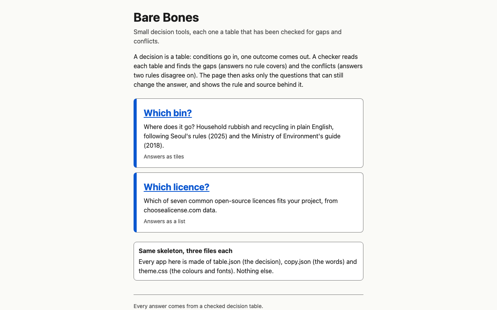

# Bare Bones

A skeleton for small decision tools. The decision is a table, a checker proves the table has no holes and no contradictions, and a static page asks only the questions that can still change the answer.



**Live: <https://seunghyeon1004.github.io/bare-bones-kiro/>**

- [Which bin?](https://seunghyeon1004.github.io/bare-bones-kiro/which-bin/): where a household item goes under South Korea's separate-discharge rules (Seoul 2025 and the Ministry of Environment guide), in English.
- [Which licence?](https://seunghyeon1004.github.io/bare-bones-kiro/which-licence/): which of seven common open-source licences fits a project, from choosealicense.com's data. Not legal advice.

Built for Kiroween 2026, category **Skeleton Crew**. Built with Kiro CLI: see [`.kiro/README.md`](.kiro/README.md).

## Why a table

Many small web tools are a decision in disguise: which bin, which licence, which form, which visa. They usually end up as a pile of if-statements, and nobody can tell whether the pile has a hole (a case nobody answered) or a contradiction (two branches that answer the same case differently).

A decision table is data. Each condition has a fixed set of answers, each rule says which answers lead to which outcome and where that rule comes from, and "any" is written by leaving a condition out. Because it is data, a program can check all of it:

```
$ npm run bones -- check skeleton/examples/which-bin-broken.table.json
gaps: 16
  kind=paper-cup, soiled=yes, broken=no, amount=small, glass-type=ordinary, coated=no, clear-drink=no
  ...
conflict: receipt -> general-waste vs receipt-as-paper -> paper, e.g. kind=receipt, soiled=no, ...
failed
```

That broken copy of Which bin? has one rule removed and one rule added. The checker names the hole with a concrete example (a dirty, uncoated paper cup now has no answer) and the contradiction with the two rules and an example item. The real table passes: 7 conditions, 960 combinations, 33 rules, 0 gaps, 0 conflicts. The build refuses to publish a table that does not.

## What the skeleton does

- **Check** (`skeleton/engine`): structural errors with a path (`rules[3].when.kind`), every gap (count and up to 20 examples), every conflicting pair of rules with an example. Plain TypeScript, no dependencies, so the same code runs in the CLI, the MCP server and the browser.
- **Decide**: from any set of answers, in any order, either the outcome or the next question. The next question is always one that can still change the outcome, chosen so its worst answer leaves the fewest outcomes open. It stops as soon as the outcome is decided. A paper box takes two questions out of seven, a receipt one.
- **Explain**: the outcome comes with the rule that fired, the answers that mattered, the rule's source with its dates, and the questions it skipped "because they could not change the answer".
- **Page shell** (`skeleton/shell`): turns any valid table into a one-question-at-a-time page. Real buttons, keyboard only works, focus moves to the new question, light and dark, 360 px phones, the answers in the URL hash so a result can be shared, "show the whole table" as a real HTML table. Static files: no login, no server, no tracking, no network requests, and the title and intro are in the HTML before the script runs.
- **CLI** (`skeleton/cli`): `npm run bones -- check <table.json>` (exit 0 pass, 1 fail, 2 usage) and `npm run bones -- new <name>`, which copies the template app into `apps/<name>/`. The next `npm run build` publishes it with no other change.
- **MCP server** (`skeleton/mcp`, dev only): `check_table` and `evaluate`, so an agent editing a table can check it.

## Two apps, three files each

```
$ diff -rq apps/which-bin apps/which-licence
Files apps/which-bin/copy.json and apps/which-licence/copy.json differ
Files apps/which-bin/table.json and apps/which-licence/table.json differ
Files apps/which-bin/theme.css and apps/which-licence/theme.css differ
```

Each app is `table.json` (the decision), `copy.json` (every word on the page that is not in the table, the answer style, the footer) and `theme.css` (colour, font and size tokens only; the build rejects any selector but `:root`). Which bin? uses big tiles, warm colours and large type; Which licence? uses a list with a sentence per option, ink on paper and a serif heading. The skeleton under them is the same code.

| | Which bin? | Which licence? |
| --- | --- | --- |
| Conditions, combinations, rules | 7, 960, 33 | 4, 32, 7 |
| Questions asked (most, of all) | 4 of 7 | 3 of 4 |
| Sources | Seoul Metropolitan Government (2025), Ministry of Environment guide (2018) | choosealicense.com licence data, CC BY 3.0 |
| Where the sources are silent | "Ask your district office" (a plastic container with food rinsing will not remove) | The nearest licence, with the reason in the rule's note |

Every rule cites a row in [`docs/sources/README.md`](docs/sources/README.md), which quotes the Korean source line with an English gloss. A test fails if a rule cites a row that is not there.

## Run it

Node 22 or later.

```
npm ci
npm run build            # checks every table, writes dist/
node scripts/serve.mjs   # http://127.0.0.1:4173/bare-bones-kiro/ (PORT to change)
npm run bones -- check apps/which-bin/table.json
npm run bones -- new my-app && npm run build
```

Tests:

```
npm run typecheck
npm test                 # 93 vitest tests, including 12 fast-check properties
npm run test:e2e         # 12 Playwright tests in headless Chromium, with axe in light and dark
```

The engine's guarantees are in [`.kiro/steering/invariants.md`](.kiro/steering/invariants.md), each proved by a named property test: a reported gap matches no rule, a reported conflict matches both rules, a passing table gives exactly one outcome for every combination, check agrees with brute force, decide ignores answer order, only asks relevant questions, stops exactly when decided, a full walk equals evaluating the whole combination, skipped questions really cannot change the outcome, and the engine is pure.

## Layout

```
skeleton/engine     validate, check, decide, format (no imports)
skeleton/shell      page script, CSS, landing page
skeleton/build      builds dist/ from apps/
skeleton/cli        bones check, bones new
skeleton/mcp        dev MCP server
skeleton/template   the app `bones new` copies
skeleton/examples   tables broken on purpose
apps/which-bin      table.json, copy.json, theme.css
apps/which-licence  table.json, copy.json, theme.css
test/, e2e/         vitest and Playwright
.kiro/              steering, specs, agents, hooks, MCP settings
docs/               brief, sources, Kiro evidence
```

## Limits

Which bin? follows Seoul's published rules; districts differ, and the page says so. Which licence? covers seven licences and is not legal advice. The skeleton handles up to 100,000 combinations per table (decide takes about 80 ms at that size on a laptop); it has no editor, no accounts and no translations.

## Licence

MIT, see [LICENSE](LICENSE). The licence facts in Which licence? come from choosealicense.com (CC BY 3.0).
