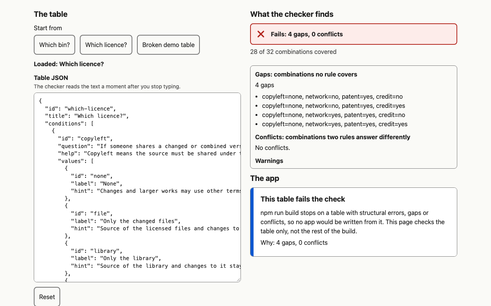

# Bare Bones

A skeleton for small decision tools. You write the decision as a table. A checker proves the table has no holes and no contradictions, and a static page asks only the questions that can still change the answer.


**Live: <https://seunghyeon1004.github.io/bare-bones-kiro/>**

- [Playground](https://seunghyeon1004.github.io/bare-bones-kiro/playground/): break a table and watch the checker catch it. Delete one rule from the licence table and a gap appears, with an example, and the app beside it refuses to run. Press Undo and it comes back.
- [Which bin?](https://seunghyeon1004.github.io/bare-bones-kiro/which-bin/): where a household item goes under South Korea's separate-discharge rules (Seoul 2025 and the Ministry of Environment guide), in English. Type "pizza" or "bottle" to find the item.
- [Which licence?](https://seunghyeon1004.github.io/bare-bones-kiro/which-licence/): which of seven common open-source licences fits a project, from choosealicense.com's data. Not legal advice.

Built for Kiroween 2026, category **Skeleton Crew**. Built with Kiro CLI; the full record is in [`.kiro/README.md`](.kiro/README.md).

## Why a table

Plenty of small web tools are a decision in disguise: which bin, which licence, which form, which visa. Most end up as a pile of if-statements, and nobody can say whether the pile has a hole (a case nobody answered) or a contradiction (two branches that answer the same case differently).

A decision table is data. Each condition has a fixed set of answers. Each rule says which answers lead to which outcome and where the rule comes from, and you write "any" by leaving a condition out. Since it is data, a program can check every case:

```
$ npm run bones -- check skeleton/examples/which-bin-broken.table.json
gaps: 16
  kind=paper-cup, soiled=yes, broken=no, amount=small, glass-type=ordinary, coated=no, clear-drink=no
  ...
conflict: receipt -> general-waste vs receipt-as-paper -> paper, e.g. kind=receipt, soiled=no, ...
failed
```

That broken copy of Which bin? has one rule taken out and one added. The checker names the hole with an example (a dirty, uncoated paper cup now has no answer) and the contradiction with both rules and an example item. The real table passes: 7 conditions, 960 combinations, 33 rules, 0 gaps, 0 conflicts. The build will not publish a table that fails, and the playground shows the same check live in the browser.



## What the skeleton does

- **Check** (`skeleton/engine`): structural errors with a path (`rules[3].when.kind`), every gap (a count and up to 20 examples), every conflicting pair of rules with an example. Plain TypeScript with no dependencies, so the same code runs in the CLI, the MCP server, the playground and the app pages.
- **Decide**: from any set of answers, in any order, it returns either the outcome or the next question. The next question is always one that can still change the outcome, picked so its worst answer leaves the fewest outcomes open, and it stops as soon as the outcome is settled. A greasy paper box takes two questions out of seven; a receipt takes one.
- **Explain**: each outcome comes with the rule that fired, the answers that mattered, the rule's source and its dates, and the questions it skipped "because they could not change the answer".
- **Page shell** (`skeleton/shell`): turns any valid table into a one-question-at-a-time page. Real buttons; it works with the keyboard alone; focus moves to the new question; light and dark; phones down to 360 px. The answers live in the URL hash so a result can be shared, and "show the whole table" is a real HTML table. Two optional extras are switched on by `copy.json` alone: pictograms on the answer tiles and a keyword filter box. Static files: no login, no server, no tracking, no network requests.
- **Playground** (`skeleton/playground`): a table editor next to the live checker, with the shell mounted on the table you are editing.
- **CLI** (`skeleton/cli`): `npm run bones -- check <table.json>` (exit 0 pass, 1 fail, 2 usage) and `npm run bones -- new <name>`, which copies the template app into `apps/<name>/`. The next `npm run build` publishes it, no other change needed.
- **MCP server** (`skeleton/mcp`, dev only): `check_table` and `evaluate`, so an agent editing a table can check it.

## Two apps, three files each

```
$ diff -rq apps/which-bin apps/which-licence
Files apps/which-bin/copy.json and apps/which-licence/copy.json differ
Files apps/which-bin/table.json and apps/which-licence/table.json differ
Files apps/which-bin/theme.css and apps/which-licence/theme.css differ
```

Each app is `table.json` (the decision), `copy.json` (every word on the page that is not in the table, plus the answer style, the pictograms and the filter keywords) and `theme.css` (colour, font and size tokens only; the build rejects any selector except `:root`). Which bin? has big tiles with line pictograms, a filter box, warm colours and large type. Which licence? has a list with a sentence under each option, ink-on-paper colours and a serif heading. Underneath, both run the same code.

| | Which bin? | Which licence? |
| --- | --- | --- |
| Conditions, combinations, rules | 7, 960, 33 | 4, 32, 7 |
| Most questions asked | 4 of 7 | 3 of 4 |
| Sources | Seoul Metropolitan Government (2025), Ministry of Environment guide (2018) | choosealicense.com licence data, CC BY 3.0 |
| Where the sources are silent | "Ask your district office" (a plastic container with food that rinsing will not remove) | The nearest licence, with the reason in the rule's note |

Every rule cites a row in [`docs/sources/README.md`](docs/sources/README.md), which quotes the Korean source line next to an English gloss. A test fails if a rule cites a row that is not there.

## Run it

Node 22 or later.

```
npm ci
npm run build            # checks every table, writes dist/
node scripts/serve.mjs   # http://127.0.0.1:4173/bare-bones-kiro/ (set PORT to change)
npm run bones -- check apps/which-bin/table.json
npm run bones -- new my-app && npm run build
```

Tests:

```
npm run typecheck
npm test                 # 137 vitest tests, 13 of them fast-check properties
npm run test:e2e         # 20 Playwright tests in headless Chromium, with axe in light and dark
```

The engine's guarantees are in [`.kiro/steering/invariants.md`](.kiro/steering/invariants.md), and each one is proved by a named property test: a reported gap matches no rule; a reported conflict matches both rules; a passing table gives exactly one outcome for every combination; check agrees with brute force; decide ignores answer order, only asks relevant questions, and stops exactly when the outcome is decided; a full walk gives the same result as evaluating the whole combination; skipped questions really cannot change the outcome; and the engine is pure.

## Layout

```
skeleton/engine      validate, check, decide, format (no imports)
skeleton/shell       page script, CSS, landing page
skeleton/playground  table editor + live check + mounted shell
skeleton/build       builds dist/ from apps/
skeleton/cli         bones check, bones new
skeleton/mcp         dev MCP server
skeleton/template    the app `bones new` copies
skeleton/examples    tables broken on purpose
apps/which-bin       table.json, copy.json, theme.css
apps/which-licence   table.json, copy.json, theme.css
test/, e2e/          vitest and Playwright
.kiro/               steering, specs, agents, hooks, MCP settings
docs/                brief, sources, Kiro evidence
```

## Limits

Which bin? follows Seoul's published rules. Districts differ, and the page says so. Which licence? covers seven licences and is not legal advice. The skeleton handles up to 100,000 combinations per table (decide takes about 80 ms at that size on a laptop). It has no accounts, no saving and no translations, and the playground is a demo of the checker, not an app builder.

## Licence

MIT, see [LICENSE](LICENSE). The licence facts in Which licence? come from choosealicense.com (CC BY 3.0).
